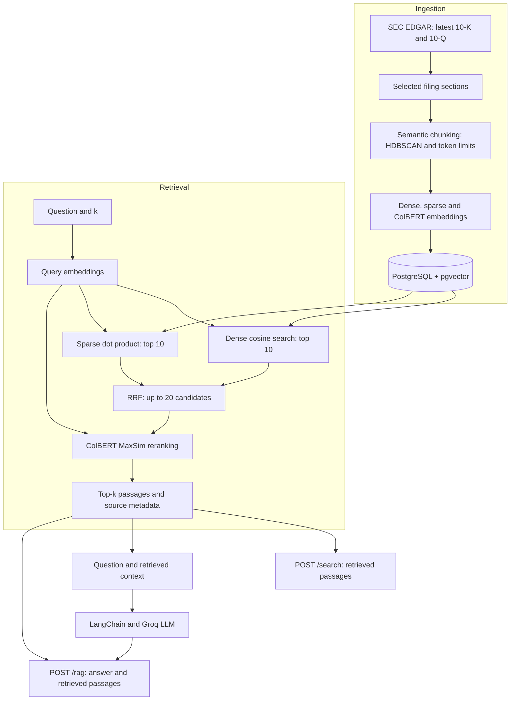

# global-intelligence-rag

A project for studying retrieval-augmented generation (RAG) over public corporate
documents. It collects SEC filings, retrieves relevant passages with hybrid search,
and uses a language model to answer questions with the retrieved context.

The project is under development, with a focus on embeddings, semantic chunking,
retrieval and the integration of these components into an API.

## What it does

- Fetches the latest **10-K** and **10-Q** filings for the configured companies
  directly from SEC EDGAR.
- Extracts selected sections and splits their text using semantic clustering and
  token-aware chunking.
- Generates dense, sparse and ColBERT embeddings for each chunk.
- Stores text, embeddings and source metadata in **PostgreSQL with pgvector**.
- Combines dense and sparse rankings using **Reciprocal Rank Fusion (RRF)**, then
  reranks the candidates with **ColBERT**.
- Exposes search and RAG through **FastAPI**.
- Generates answers using **LangChain and a model hosted on Groq**, returning the
  retrieved passages and their sources alongside the answer.

## Architecture



The ingestion and query flows share the embedding service and database repository.
The API reuses the same retrieval pipeline for `/search` and `/rag`.

## Stack

| Component | Implementation |
| --- | --- |
| Document collection | EdgarTools |
| Chunking | Sentence Transformers, HDBSCAN and a tokenizer |
| Dense embeddings | `sentence-transformers/all-MiniLM-L6-v2` |
| Sparse embeddings | FastEmbed `Qdrant/bm25` representations |
| Reranking | `colbert-ir/colbertv2.0` |
| Storage | PostgreSQL, pgvector, SQLAlchemy Core and psycopg |
| Data contracts and configuration | Pydantic and pydantic-settings |
| API | FastAPI and Uvicorn |
| Answer generation | LangChain and ChatGroq |

The language model is configured through `GROQ_MODEL`; `.env.example` uses
`openai/gpt-oss-20b`, served by Groq.

## Project structure

```text
src/global_intelligence/
├── config.py              # Environment settings and ingestion defaults
├── models/                # Typed filings, embeddings, chunks and API contracts
├── database/
│   ├── connection.py      # Database engine and explicit schema setup
│   ├── schema.py          # Table and column definitions
│   └── repository.py      # Persistence and database queries
├── embeddings/
│   └── service.py         # Document and query embeddings
├── ingestion/
│   ├── edgar_client.py    # Filing collection and section extraction
│   ├── chunker.py         # Semantic chunking
│   └── pipeline.py        # Collection, encoding and persistence
├── retrieval/
│   ├── sparse.py          # Sparse similarity and ranking
│   ├── fusion.py          # Reciprocal Rank Fusion
│   ├── reranker.py        # ColBERT scoring
│   ├── pipeline.py        # Hybrid retrieval and score normalization
│   └── rag.py             # Context construction and answer generation
└── api/
    ├── main.py            # FastAPI application
    └── routers/           # Health, search and RAG endpoints

scripts/
├── setup_database.py      # Recreate the configured table
├── ingest.py              # Collect and index filings
└── search.py              # Run an example query from the command line
```

## Run locally

Requirements: Python **3.12.6 or newer**, [uv](https://docs.astral.sh/uv/), and Docker
with Docker Compose.

### 1. Install dependencies and configure the environment

```bash
uv sync
cp .env.example .env
```

Edit `.env` with your EDGAR contact email and Groq API key. The example also
contains the database URL, embedding models and Groq model.

Defaults in `src/global_intelligence/config.py` select `AAPL` and both `10-K` and
`10-Q`. Update `Settings.tickers` to include additional companies. The table name
defaults to `document_chunks` and can be configured with `TABLE_NAME`.

### 2. Start PostgreSQL

```bash
docker compose up -d postgres
```

Compose starts PostgreSQL with pgvector on port `5432` and persists its data in a
Docker volume.

### 3. Ingest the filings

```bash
uv run scripts/ingest.py
```

The script collects the configured reports, generates embeddings and confirms how
many chunk IDs were stored. The first execution may download the embedding and
chunking models, so it can take longer.

**The current ingestion flow drops and recreates the configured table on every
run.** `uv run scripts/setup_database.py` performs that same reset separately;
running it before ingestion is optional.

### 4. Start the API

```bash
uv run uvicorn global_intelligence.api.main:app --app-dir src --reload
```

- API: `http://127.0.0.1:8000`
- Interactive documentation: `http://127.0.0.1:8000/docs`

Starting the API does not run ingestion or reset tables.

To query the existing database without starting the API:

```bash
uv run scripts/search.py
```

## API

| Method | Endpoint | Purpose |
| --- | --- | --- |
| `GET` | `/health` | Returns `{"status": "ok"}` when the API is responding |
| `POST` | `/search` | Returns passages, source metadata and normalized ColBERT scores |
| `POST` | `/rag` | Returns a generated answer and the passages supplied as context |

### Search

```bash
curl -X POST http://127.0.0.1:8000/search \
  -H 'Content-Type: application/json' \
  -d '{"query": "What are the main financial risks?", "k": 3}'
```

`SearchResponse.results` contains objects with `content`, `metadata` and
`colbert_score`. Metadata includes `ticker`, `company_name`, `form_type`,
`report_date` and `source_url`. The report date identifies the end of the reporting
period. IDs, embedding matrices and intermediate ranking scores remain internal.

### RAG

```bash
curl -X POST http://127.0.0.1:8000/rag \
  -H 'Content-Type: application/json' \
  -d '{"query": "What credit risks are associated with the investment portfolio?", "k": 3}'
```

`RagResponse` contains:

- `query`: the original question.
- `answer`: the language model's response.
- `results`: the passages and source metadata used to build the context.

Both requests accept `query` and a positive `k`, which defaults to `3`. The current
retrieval configuration considers at most 20 fused candidates, so increasing `k`
beyond that does not expand the candidate pool.
